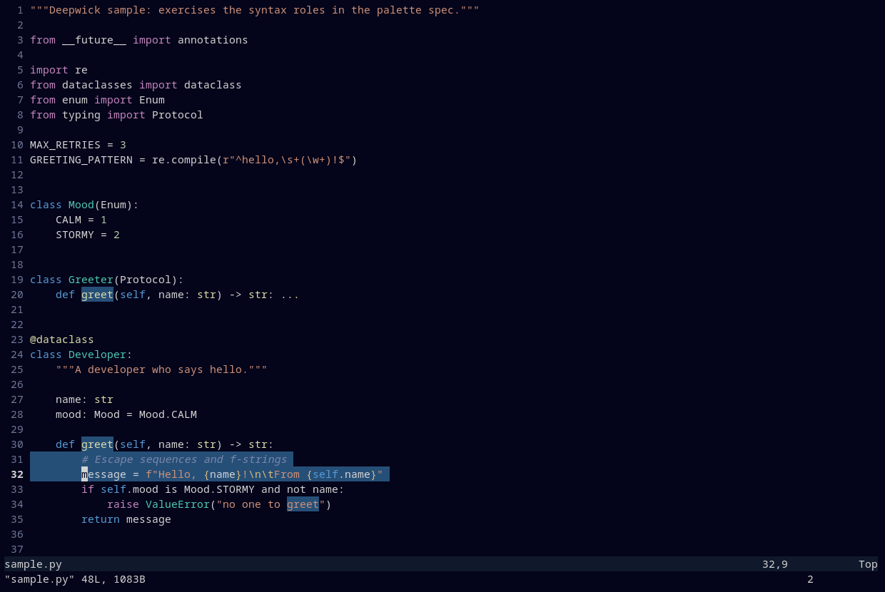

# Deepwick for Vim

Deepwick colors for [Vim](https://www.vim.org) 8.2 and later.

> Deepwick is an unofficial theme derived from
> [Polywick Blue](https://vscode.polywickstudio.net) by Polywick Studio (MIT).
> Not affiliated with Polywick Studio.



## Install

With Vim's own packages:

```sh
git clone https://github.com/deepwick/vim ~/.vim/pack/deepwick/start/deepwick
```

Or with a plugin manager, e.g. [vim-plug](https://github.com/junegunn/vim-plug):

```vim
Plug 'deepwick/vim'
```

Then in your `~/.vimrc`:

```vim
set termguicolors
colorscheme deepwick
```

## vim-airline

The repo also ships a [vim-airline](https://github.com/vim-airline/vim-airline)
theme. With the repo installed as above:

```vim
let g:airline_theme = 'deepwick'
```

Modes follow the Neovim port: normal Blue, insert Green, visual Magenta,
replace Red, command line Yellow. lightline isn't covered.

## Notes

- `set termguicolors` gives the exact Deepwick colors. Without it, Vim uses
  [Deepwick's 256-color palette](https://github.com/deepwick/spec#256-color-palette)
  and leaves the background to the terminal, so pair it with a Deepwick
  terminal theme
  ([Konsole](https://github.com/deepwick/konsole),
  [Ptyxis](https://github.com/deepwick/ptyxis),
  [Alacritty](https://github.com/deepwick/alacritty),
  [Ghostty](https://github.com/deepwick/ghostty)). Inside tmux, Vim may also
  need `let &t_8f = "\e[38;2;%lu;%lu;%lum"` and
  `let &t_8b = "\e[48;2;%lu;%lu;%lum"` for 24-bit color.
- In 256-color mode diffs use tinted backgrounds from Deepwick's 256-color
  palette; they are brighter than the 24-bit ones.
- Vim's built-in syntax files are coarser than Tree-sitter, so some colors
  differ from the [Neovim port](https://github.com/deepwick/neovim) and
  [bat](https://github.com/deepwick/bat):
  - Python `return`, `pass`, `yield`, `with` and `lambda` are Blue keywords,
    not Magenta control flow; `in` in a `for` loop is plain like other
    operators.
  - Python builtins (`print`, `len`, but also `str` and `int`) are Yellow, like
    functions; exception classes (`ValueError`) are Teal. ALL_CAPS constants
    and enum members aren't highlighted.
  - A C `#define` line is Magenta as a whole: Vim gives the directive and the
    macro name one group. `#include` and `#if` lines are bold.
- Vim's Python syntax colors `True`, `False` and `None` like functions, so the
  theme re-declares them as `pythonBoolean` (Blue) when a Python file loads.
- gVim works, but the theme targets terminal Vim.
- `colors/deepwick.vim` and the airline theme are generated: run `PYTHONPATH=../spec python3 generate.py`
  with a [deepwick spec](https://github.com/deepwick/spec) checkout next to
  this repo.

Tested with Vim 9.2.1202.

## License

MIT. See [LICENSE](LICENSE).
